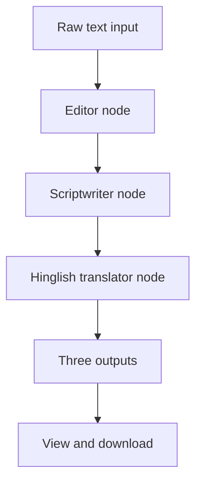

# Hinglish Script Writer

A Streamlit-based AI writing workspace that transforms raw text into three staged outputs: edited text, an engaging video script, and a natural Hinglish version for an Indian audience.

The application is powered by a sequential LangGraph workflow. Each stage uses the Groq-hosted `openai/gpt-oss-20b` model and passes its output to the next stage.

## Features

- Paste raw narration, notes, or an early script draft.
- Clean grammar, spelling, and sentence flow while preserving the original message.
- Rewrite edited text as an engaging, conversational video script.
- Localize the video script into natural Hindi-English (Hinglish).
- View each stage's output in a separate tab.
- Download an individual stage or all three outputs as text files.
- Load a sample input to try the pipeline.

## Workflow



| Stage | LangGraph node | Purpose |
|---|---|---|
| 1 | `editor` | Fix grammar and spelling; improve clarity and transitions while keeping the core meaning |
| 2 | `scriptwriter` | Turn the edited content into a punchy, spoken-word video script |
| 3 | `translater` | Adapt the script into natural, conversational Hinglish rather than translating word for word |

All three nodes run sequentially. The current implementation uses the same Groq model configuration for each stage.

## Tech Stack

- **Python** — application and pipeline logic
- **Streamlit** — user interface and result downloads
- **LangGraph** — sequential state-graph orchestration
- **LangChain Groq** — LLM integration
- **Groq model** — `openai/gpt-oss-20b`
- **python-dotenv** — local environment configuration

## Project structure

```text
Hinglish_script_writer/
├── app.py              # Streamlit interface
├── project.py          # LangGraph pipeline and three nodes
├── requirements.txt
└── .env                # Create locally; do not commit
```

## Getting started

### Requirements

- Python 3.10+
- A Groq API key

### 1. Clone the repository

```bash
git clone https://github.com/srini526/Hinglish_script_writer.git
cd Hinglish_script_writer
```

### 2. Create and activate a virtual environment

```bash
python -m venv .venv
```

**Windows PowerShell**
```powershell
.\.venv\Scripts\Activate.ps1
```

**macOS / Linux**
```bash
source .venv/bin/activate
```

### 3. Install dependencies

```bash
pip install -r requirements.txt
```

### 4. Configure the API key

Create a `.env` file in the repository root:

```env
GROQ_API_KEY=your_groq_api_key
```

The Streamlit app also supports a `GROQ_API_KEY` entry in Streamlit Secrets. Never commit real credentials.

### 5. Run the application

```bash
streamlit run app.py
```

Open the local URL printed by Streamlit.

## Output files

The interface provides downloads for:

- `edited_text.txt`
- `video_script.txt`
- `hinglish_script.txt`
- `script_studio_results.txt` (all stages in one file)

## Notes and limitations

- The workflow is sequential; it does not currently use separate specialized model providers for each stage.
- Outputs depend on the submitted source text and model response.
- The app does not publish scripts to YouTube or social platforms.
- The current state is held in Streamlit session state; this repository does not implement a persistent user library or database.

---

A practical LangGraph project demonstrating multi-stage LLM text transformation and localization.
